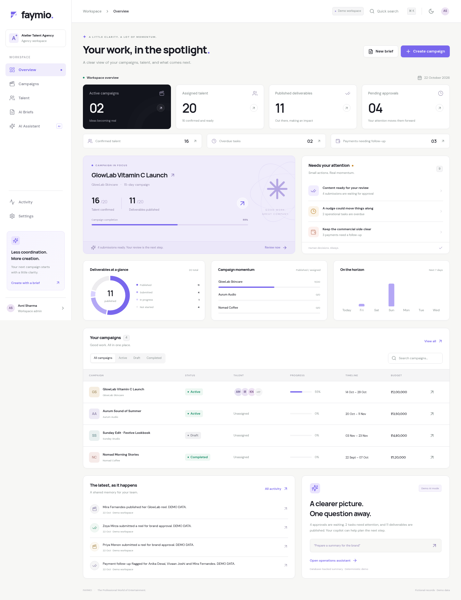

# FAYMIO

**The Professional World of Entertainment.** An agency operations MVP for managing creator campaigns, deliverables, approvals, tasks, and commercial follow-ups.

## Open Faymio on your computer

`localhost` refers to the computer running the server. A server inside a cloud workspace cannot be reached through your own computer's localhost address. Download or clone this project to your computer first; this workspace does not expose a public preview URL.

### Windows quickstart

1. Install the current [Node.js LTS](https://nodejs.org) (22.12 or newer).
2. [Download this branch as a ZIP](https://github.com/agarwalmanan0830-create/Faymio-/archive/refs/heads/codex/faymio-mvp.zip), sign into your GitHub account if asked, and choose **Extract All**.
3. Inside the extracted project folder, double-click **start-faymio.bat**. Keep the terminal window open while using Faymio.

The launcher prepares the local environment, installs missing dependencies, applies migrations, seeds the demo, starts Faymio on your computer, and opens the browser after both the workspace API and dashboard respond. The first launch can take a few minutes. Existing `.env` files and saved records are preserved.

On macOS, open `start-faymio.command`. From a terminal on any supported computer, run this inside the downloaded project folder:

```bash
npm run demo
```



The image above is a screenshot of the working demonstration workspace.

## Run locally

Requires **Node.js 22.12+**, npm, and a writable local disk. No paid service is required.

```bash
npm ci
cp .env.example .env
npm run setup
npm run dev
```

Open **http://localhost:3000/dashboard**. `setup` generates Prisma Client, applies checked-in migrations, and seeds the demonstration organization. The seed is repeatable: it preserves an already seeded workspace and its edits. To start a fresh demonstration, stop the app, remove `prisma/dev.db`, and run `npm run setup` again. This deletes all local saved data; export anything you need first.

The demo opens as the fictional Atelier Talent Agency workspace with a server-selected demonstration administrator. **This is demo access, not production authentication.** All seeded names, portfolios, brands, commercial records, and work histories are fictional. Seed portfolio links use `example.com` and `example.test`.

To test the optimized local build:

```bash
npm run build
ALLOW_DEMO_IN_PRODUCTION=true npm start
```

`NODE_ENV=production` refuses all workspace APIs unless `DEMO_MODE=true` **and** `ALLOW_DEMO_IN_PRODUCTION=true`. The second flag is an explicit opt-in for an insecure demonstration identity. Do not enable it for real customer data or expose this demo to an untrusted network. For normal local use, use `npm run dev`.

## Implemented

- **Overview `/dashboard`**: persisted KPI calculations, campaign completion, deliverable status chart, upcoming deadlines, priority queues, campaign filtering/search, recent activity, and a clearly labeled deterministic status summary. KPI drill-downs show the matching stored records across campaigns.
- **Campaigns `/campaigns` and `/campaigns/[id]`**: create, edit, and archive campaigns; assign existing talent; track invitations and confirmations; submit URLs; request changes, approve, and publish; set deadlines; add/complete tasks; internal notes; record invoice amounts and payment status; follow-up flags; history and CSV export.
- **Talent `/talent`**: create, edit, search, category/city/availability filters, profile details, manually verified flag, links, rate ranges, assignment history, and confirmation before deletion. Deletion archives the profile and retains campaign history.
- **Briefs `/briefs`**: paste a brief, extract structured fields, edit them, see missing information, regenerate, use manual entry, save/load database drafts, and explicitly review before campaign creation.
- **Operations assistant `/assistant`**: database-grounded approvals, overdue work, payment follow-ups, summaries, and copyable reminder drafts with supporting records and campaign links. Unsupported requests and unknown campaigns are explained clearly. No external messages are sent.
- **Activity and Settings**: searchable activity, campaign filter, theme preference, workspace information, JSON export, and explicit demonstration/security notes.
- Responsive desktop/mobile layouts, original Faymio mark, semantic theme tokens, self-hosted DM Sans/Manrope fonts, light/dark mode, Radix accessible dialogs, validation, skeletons, empty/error states, and toast feedback.

## Architecture

Next.js 15 App Router, React 19, TypeScript, Tailwind CSS, Radix primitives with local shadcn-style components, Lucide, Recharts 2, Prisma 6, SQLite, Zod, Sonner, Vitest, and Playwright. Stable pinned dependency versions and `package-lock.json` make installation repeatable. Recharts 2 is retained for its compatible React dashboard API; evaluate Recharts 3 and current security-patched dependencies before production deployment.

```text
src/app/                 Routes, screens, and server API handlers
src/components/          Shared UI, navigation, campaign/talent/AI styling
src/lib/ai/              Brief parser, provider adapter, read-only operations
src/lib/                 Prisma client, metrics, formatting utilities
src/server/              Organization context, validation, transaction services
src/types/               Serialized application contracts
prisma/schema.prisma     Relational model and organization ownership fields
prisma/migrations/       Checked-in SQLite migration
prisma/demo-data.ts      Shared, repeatable demonstration fixture
prisma/seed.ts           CLI seed entrypoint
scripts/migrate.mjs      Safe SQLite file preparation and migration runner
tests/                   Isolated database, AI, and browser journey tests
```

All reads and mutations resolve the organization on the server. Browser-supplied organization IDs do not establish access. Campaign/talent/assignment/task IDs and nested relations are checked for ownership. Related workflow changes and activity insertion use database transactions. Assignment updates include an optimistic concurrency check. Important business records are soft archived.

**Money:** integer paise throughout the database and APIs. ₹2,00,000 is `20_000_000` paise. Values must be nonnegative integers within the Prisma Int range. **Dates:** stored UTC; display uses Indian dates and Asia/Kolkata. A deadline is overdue once its exact stored timestamp has passed. The seed uses dates relative to the day it is first run; its overdue records stay overdue until completed.

The PostgreSQL migration path requires changing the Prisma datasource, generating PostgreSQL migrations, migrating/validating data, and reviewing indexes/concurrency behavior. The checked-in SQL is SQLite-specific.

## The seeded GlowLab campaign

| Stored records                                    | Count |
| ------------------------------------------------- | ----: |
| Assigned creators                                 |    20 |
| Confirmed creators                                |    16 |
| Published deliverables                            |    11 |
| Submitted content awaiting approval               |     4 |
| Additional confirmed creator with incomplete work |     1 |
| Invited creators                                  |     4 |
| Separate open overdue task records                |     2 |
| Separate unpaid payment records marked follow-up  |     3 |

Budget is ₹2,00,000 and duration is 15 days. Three other fictional campaigns and additional talent make the workspace browsable. The other campaigns start without assignments; new work naturally changes workspace totals. Completion means **published**, not merely submitted or approved. These counts are verified against actual relational records in integration tests.

## Workflow safeguards

Talent must be confirmed before submitting work. Submitted/published deliverables require an HTTP(S) URL. Required content approval follows submission; requesting changes returns work to in-progress; approval allows publication. Published work cannot move backward, and approved/published submission URLs are locked to preserve review history. Existing assignments lock the campaign's approval policy. Paid invoice records cannot also require follow-up. A payment status is only a record; it never initiates a payment. CSV cells are quoted and spreadsheet-formula prefixes neutralized.

## AI configuration

The complete workflow works without credentials. The UI labels **Demo AI mode** when deterministic parsing is used. The brief parser handles common Indian budget expressions, creator counts, duration, approval requirements, and missing-information warnings. It is intentionally bounded; review and edit extracted fields.

Optional server-only environment variables:

```dotenv
OPENAI_API_KEY="your-server-side-key"
OPENAI_MODEL="gpt-4o-mini"
```

The provider adapter calls OpenAI on the server with JSON-schema structured output, validates results using Zod, applies a 20-second brief-extraction timeout and a 15-second read-operation classification timeout, and falls back to a labeled deterministic response on provider failures. The model never writes to the database. The user explicitly reviews a brief before creating a campaign.

Supported operational questions use deterministic database queries. A configured model can classify other wording into a validated supported read-only operation; factual answers are still computed from stored records. API keys are never returned to the browser. AI request logs store operation/mode/status metadata rather than full private prompts. AI endpoints have an in-process per-organization limit of 20 requests/minute. Production needs a shared durable rate limiter and provider budget controls.

## Checks

```bash
npm run typecheck
npm run lint
npm test
npm run test:launcher
npm run build
npm run test:e2e
```

Unit/integration tests use temporary SQLite databases, apply the actual migration, and run the shared seed. Browser tests use a separate `/tmp/faymio-e2e.db` and port 3001; they do not alter the demonstration database. They use `/usr/bin/chromium` when available; otherwise run `npx playwright install chromium` once.

See `TEST_RESULTS.md` for checks actually executed in this environment and their results. The live OpenAI provider requires a real key and is not claimed as end-to-end verified here.

## Deliberately deferred

Public talent signup, social feed, public marketplace/casting, autonomous booking, contracts/e-signatures, negotiations, payment gateways, outbound messaging infrastructure, social scraping/metrics, client portals, asset uploads, and live identity verification. A verified flag only means an agency user manually marked the record verified.

## Before onboarding real customers

Replace the demonstration context with authenticated, verified organization membership; add roles and permissions, invitation/session lifecycle, tenant-aware uniqueness policy, authorization review, and retention/export/deletion policy. Deploy with TLS and a private database, secure secrets, request controls, shared rate limiting, backups/restore drills, observability, error monitoring, and dependency/security maintenance. Review CSRF protection and origin/proxy handling for the chosen hosting environment. The current origin check validates an explicit browser Origin against the incoming Host and protocol (or a server-configured `APP_ORIGIN`), ignoring forwarded headers; demo identity is not an authentication or comprehensive CSRF layer. Add durable job infrastructure only when notifications or background operations are introduced.

SQLite and a single application process suit local evaluation. Use managed PostgreSQL, migrate and validate data, load-test real agency volumes, add pagination, and review transaction concurrency before production. The MVP models one deliverable, approval, and invoice record per talent assignment; multiple assets, file versions, and split payments are deferred. Payment/invoice data is operational tracking, not accounting or reconciliation. Approval history is retained through activity logs; attachment versioning and granular review comments are future work.

Highest-value next product steps: authenticated agency teams and roles, a brand-facing approval portal, versioned asset uploads, and human-approved reminders with a durable notification queue.
